# ☕ Coffee Delivery

Projeto final da disciplina **Single Page Application (SPA)**: e-commerce fictício de cafeteria com catálogo, carrinho, checkout e confirmação de pedido. Sem backend e sem pagamento real.

- **Aplicação publicada (Render): https://coffee-delivery-drfk.onrender.com/
- **Figma de referência:** https://www.figma.com/design/yGPNTA0Yczb183EikXGIiA/Coffee-Delivery-%E2%80%A2-Projeto-Final-React?node-id=2-1297

## Objetivos

Consolidar React, TypeScript, componentes, Props, Hooks, Context API, `useReducer`, imutabilidade, rotas, formulários com validação, persistência local, estilização com tema, testes e documentação, com uso documentado de IA.

## Stack

React 18 · Vite · TypeScript (strict) · React Router · Context API + `useReducer` · React Hook Form + Zod · styled-components · Vitest + Testing Library · ESLint · ViaCEP

## Como rodar

```bash
npm install
npm run dev      # desenvolvimento (http://localhost:5173)
npm test         # testes (Vitest)
npm run lint     # ESLint + checagem de tipos (tsc)
npm run build    # build de produção
npm run preview  # servir o build localmente
```

## Funcionalidades

- Catálogo com 12 cafés, com imagem, tags, descrição e preço.
- Quantidade escolhida antes de adicionar; cafés repetidos acumulam na mesma linha do carrinho.
- Contador no Header com a soma das unidades.
- Carrinho salvo no `localStorage`.
- Checkout com endereço (rua, bairro, cidade e UF preenchidos pelo ViaCEP a partir do CEP) e forma de pagamento.
- Resumo com subtotal, entrega e total.
- Confirmação a partir de um snapshot do pedido.
- Tema claro e escuro, com a escolha salva.
- Layout responsivo a partir de 320 px.

## Decisões de projeto

- **Valores em centavos** (inteiros), formatados com `Intl.NumberFormat` para evitar erro de precisão.
- **Entrega:** taxa fixa de R$ 3,50 em `src/utils/money.ts`; carrinho vazio não cobra entrega.
- **Botão − no carrinho:** não desce de 1. Para tirar o item, usa-se "Remover".
- **Pedido concluído:** salvo em chave própria do `localStorage` (snapshot), então a tela de sucesso continua correta com o carrinho limpo.
- **Identidade visual:** segue o Style Guide do Figma (amarelo + roxo, Baloo 2 + Roboto, cards 6/36 px). Quatro cores foram ajustadas para contraste WCAG AA; a tabela está no [`TECH_SPEC.md` §8](docs/TECH_SPEC.md).
- **Tema escuro:** derivado da mesma paleta (o Figma só tem o claro). Sem escolha salva, segue `prefers-color-scheme`.
- Detalhes em [`docs/PRD_SPEC.md`](docs/PRD_SPEC.md), [`docs/TECH_SPEC.md`](docs/TECH_SPEC.md) e [`docs/TASKS_SPEC.md`](docs/TASKS_SPEC.md). Regras para o assistente de IA em [`AGENTS.md`](AGENTS.md).

## Branding com IA

| Proposta escolhida | Proposta alternativa | Símbolo no Header e favicon |
| --- | --- | --- |
| 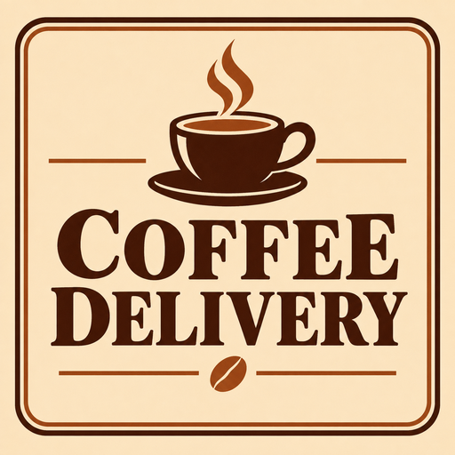 | 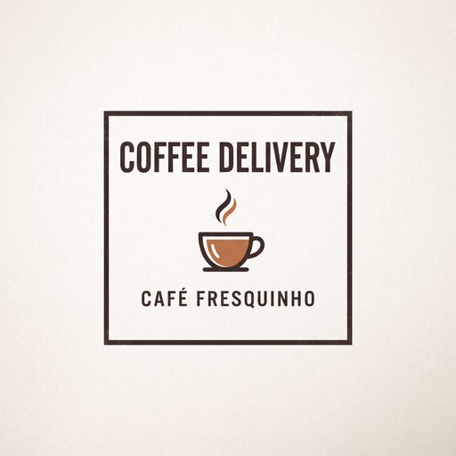 |   |

- **Ferramenta usada:** _(preencher: ex. ChatGPT/DALL·E, Gemini, Ideogram)_
- **Prompt (reconstruído):** o prompt original não ficou salvo. O texto abaixo foi reescrito para reproduzir as mesmas propostas:

  > Crie um logotipo quadrado para uma cafeteria de delivery chamada "Coffee Delivery". Estilo vintage de cafeteria, em tons de café: marrom-escuro (#4A1E0E), caramelo (#9C4A1A) e fundo creme (#FBE2BD). No centro, uma xícara com pires e três linhas de vapor ondulado. Abaixo, o nome "COFFEE DELIVERY" em duas linhas, tipografia serifada pesada. Moldura com cantos arredondados e duas linhas finas, um grão de café entre linhas horizontais na base. Visual plano, sem gradientes nem fotos, legível em tamanho pequeno. Gere também uma variação minimalista, com xícara em traço fino, nome em caixa alta sem serifa e o slogan "Café fresquinho".

- **Por que escolhi esta proposta:** tem a identidade mais forte de cafeteria. A xícara com vapor funciona sozinha como símbolo e continua reconhecível em 32 px, o que a versão minimalista não garante (traço fino demais). Os tons caramelo combinam com o amarelo do Style Guide.
- **Aplicação:** o nome em texto não fica legível em 40 px, então o Header usa só o símbolo (xícara), recortado da proposta principal, com "Coffee Delivery" escrito em Baloo 2 ao lado. O mesmo recorte vira `favicon.png` (64 px) e `apple-touch-icon.png` (180 px).
- **Claro e escuro:** o símbolo tem fundo creme próprio, então funciona nos dois temas sem trocar de arquivo (ver prints abaixo).
- **Legibilidade:** testada em 32 px (xícara e vapor reconhecíveis) e 16 px (só a silhueta). Arquivos em `docs/branding/teste-32px.png` e `teste-16px.png`.
- **Direitos de uso:** _(preencher conforme os termos da ferramenta usada; em geral, a pessoa que gera tem direito de uso comercial e acadêmico)_

## Uso de IA no desenvolvimento

O assistente de IA (Kiro) foi usado para analisar o enunciado, planejar, implementar em etapas, revisar, testar e documentar, seguindo as regras do [`AGENTS.md`](AGENTS.md). As 5 interações estão registradas em [`docs/AI_USAGE.md`](docs/AI_USAGE.md), com prompt, decisão (aceita, ajustada ou rejeitada) e evidência. O registro inclui uma proposta da IA que foi rejeitada e os erros que a IA cometeu e corrigiu.

## Qualidade

- **34 testes automatizados:** reducer, cálculos, formatação, persistência, schema Zod, `useCep` com `fetch` simulado e o fluxo completo de compra.
- **Verificações com Playwright:** sem rolagem horizontal em 320, 390, 768 e 1280 px; compra completa só com teclado, com foco visível.
- **Contraste:** textos ≥ 4,5:1 e ícones/foco ≥ 3:1 nos dois temas.

## Screenshots

### Desktop — tema claro

| Home | Checkout | Sucesso |
| --- | --- | --- |
| 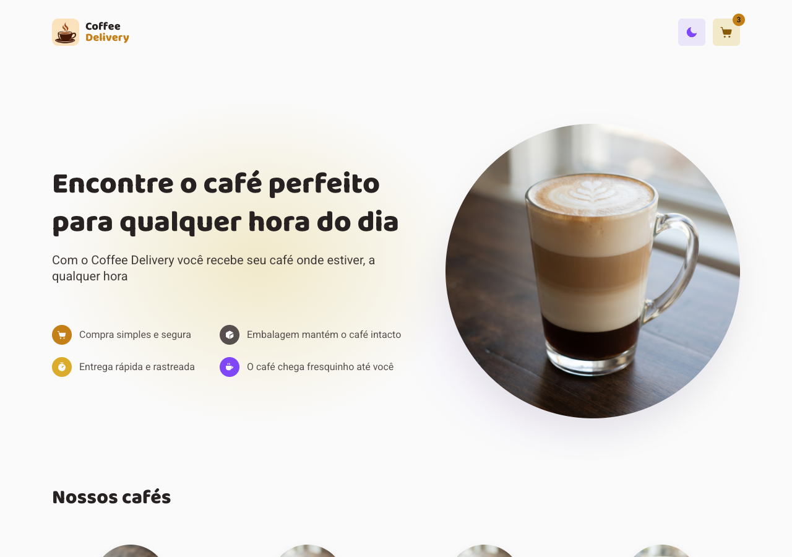 | 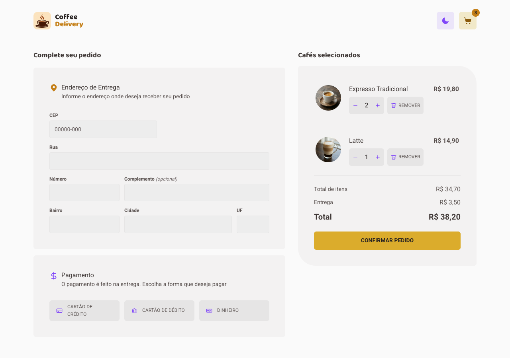 | 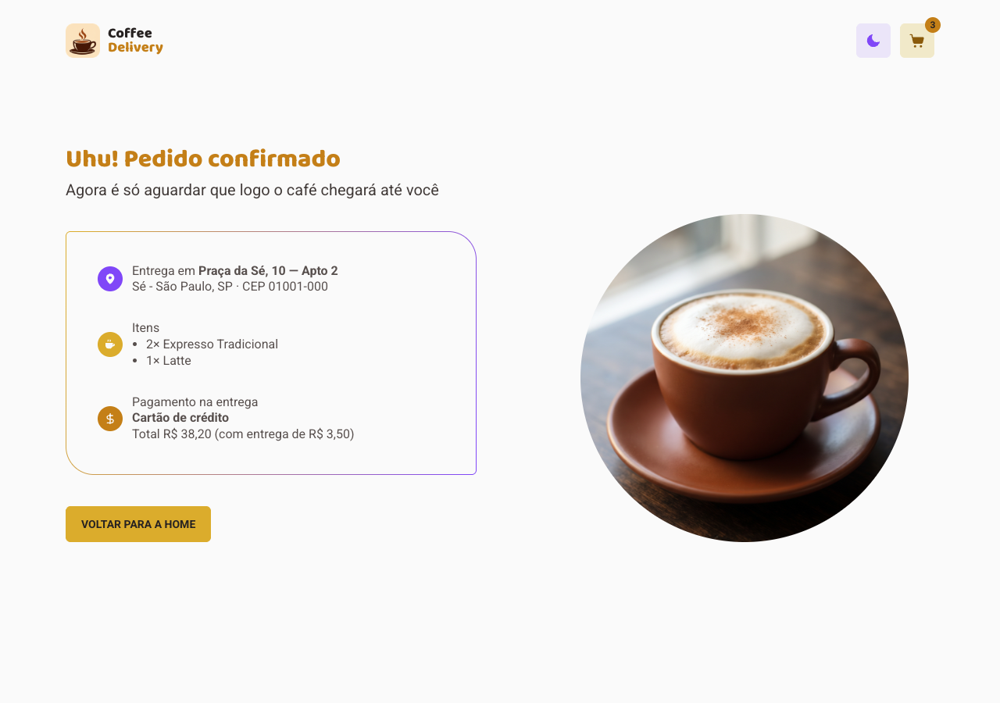 |

### Mobile — claro e escuro

| Home | Checkout | Sucesso |
| --- | --- | --- |
| 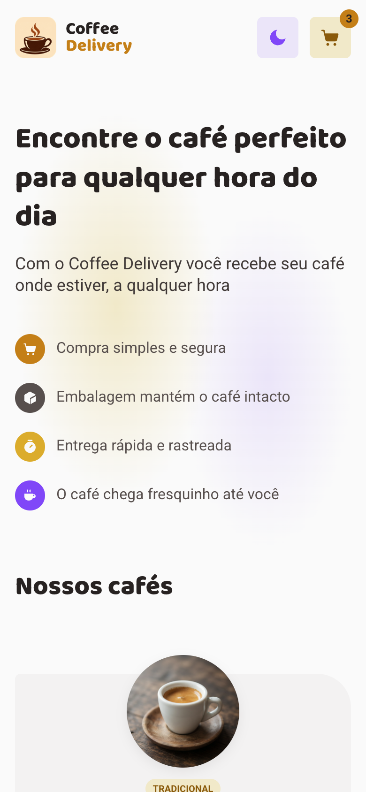 | 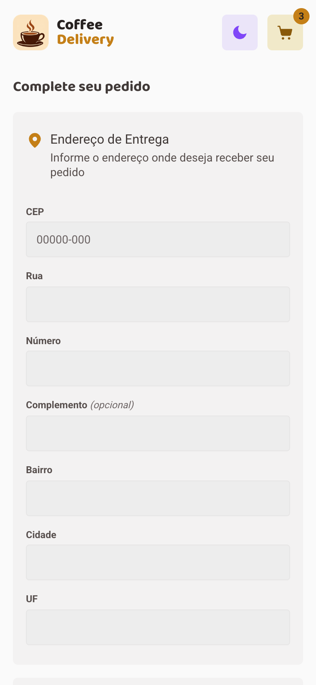 | 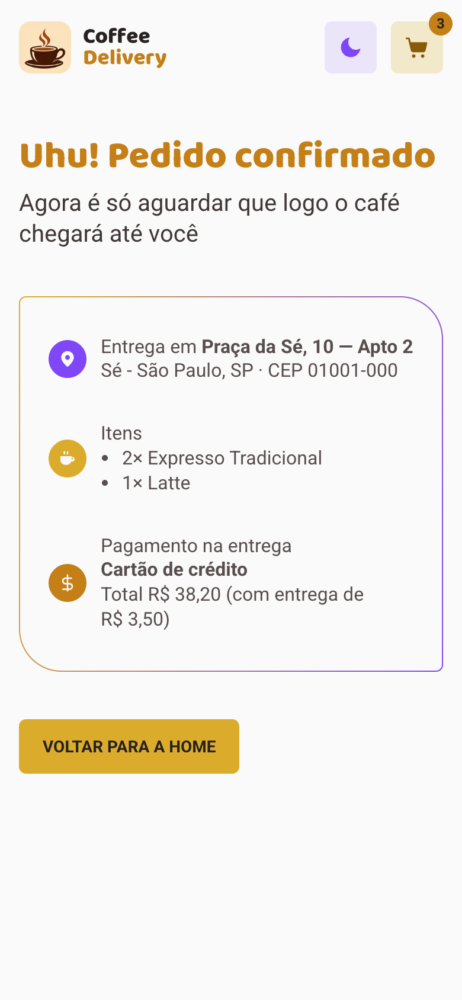 |
| 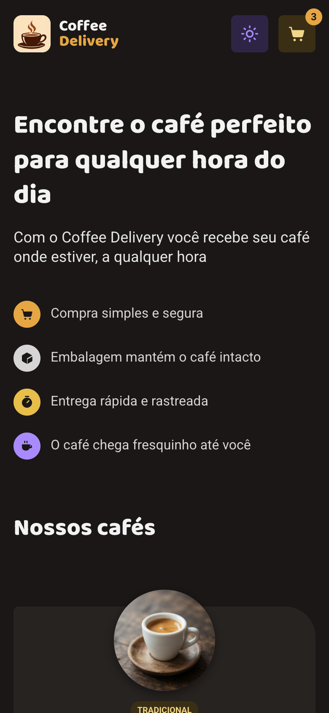 | 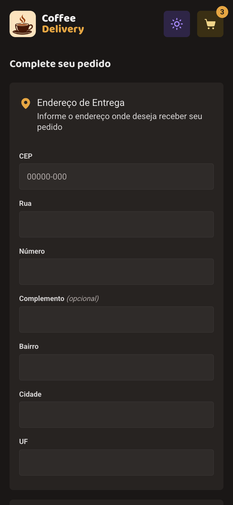 | 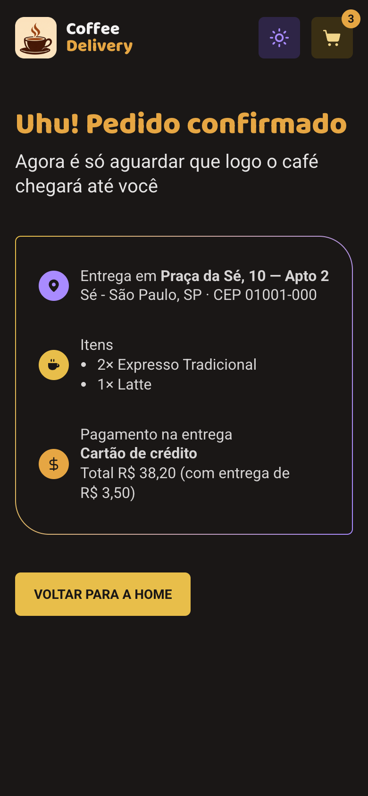 |

### Desktop — tema escuro

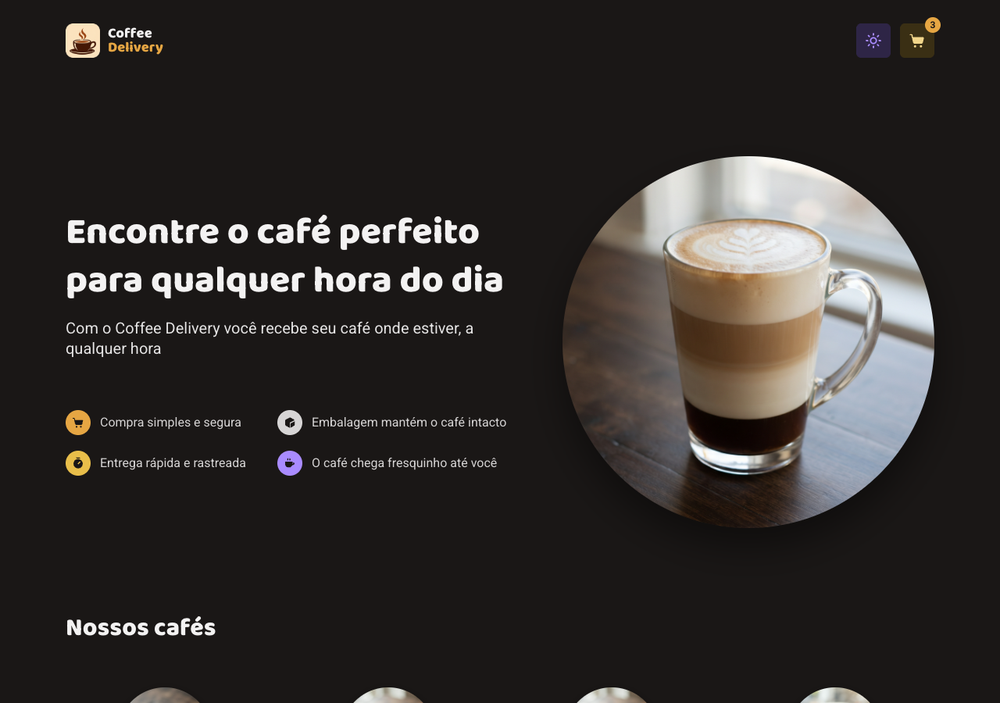

## Deploy (Render)

O arquivo `render.yaml` configura um site estático: build com `npm ci && npm run build`, publicação da pasta `dist` e uma regra de rewrite de `/*` para `/index.html`. Sem essa regra, recarregar a página em `/checkout` ou `/success` daria erro 404.

No Render: **New → Blueprint** e selecionar este repositório.

## Estrutura

```
src/
├── components/  # UI reutilizável (Header, CoffeeCard, CartItem, FormSection...)
├── contexts/    # CartProvider e ThemeProvider
├── data/        # catálogo tipado
├── hooks/       # useCart, useTheme, useLocalStorage, useCep
├── pages/       # Home, Checkout, Success, NotFound
├── reducers/    # cartReducer (ações imutáveis)
├── schemas/     # Zod do checkout
├── styles/      # tokens/temas, GlobalStyle, breakpoints
├── tests/       # Vitest + Testing Library
├── types/       # Coffee, CartItem, Order...
└── utils/       # dinheiro, totais, CEP, storage, pedido
docs/
├── PRD_SPEC.md  TECH_SPEC.md  TASKS_SPEC.md  AI_USAGE.md
├── branding/    # logos originais e testes de legibilidade
└── screenshots/
```
